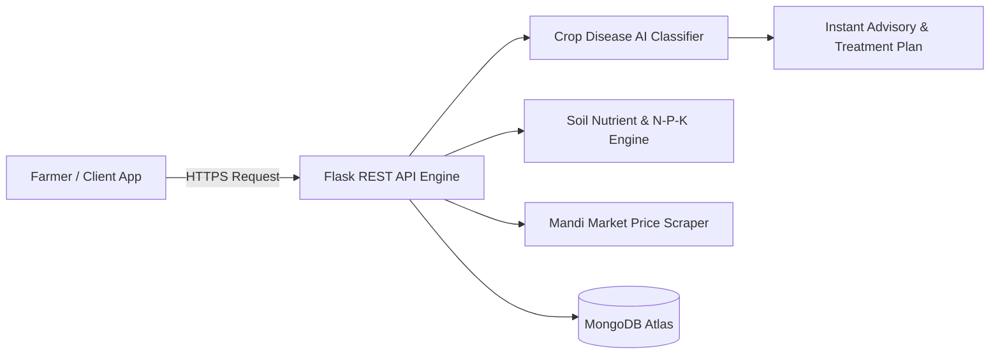

<div align="center">

  # ⚡ SK Salman Alam Ostagar — Portfolio & Showcase
  ### *Cinematic, High-Performance Full-Stack Developer Portfolio*

  [](https://github.com/salman284/My_Portfolio)
  [](https://github.com/salman284/My_Portfolio/stargazers)
  [](https://github.com/salman284/My_Portfolio/network/members)
  [](LICENSE)

  <p align="center">
    <a href="https://react.dev/"></a>
    <a href="https://www.typescriptlang.org/"></a>
    <a href="https://vitejs.dev/"></a>
    <a href="https://www.framer.com/motion/"></a>
    <a href="https://nodejs.org/"></a>
    <a href="https://www.mongodb.com/"></a>
    <a href="https://www.python.org/"></a>
  </p>

  <p align="center">
    Final-year CSE student at <strong>Supreme Knowledge Foundation (MAKAUT, 2027)</strong> • 
    <strong>Infosys Global Hackathon 2025 Finalist (Top 33 of 1,942 teams)</strong> • 
    Full-Stack MERN & Applied AI Developer
  </p>

  <p align="center">
    <a href="#-interactive-table-of-contents"><strong>Explore Docs »</strong></a> •
    <a href="#-quick-start--local-setup"><strong>Run Locally</strong></a> •
    <a href="#-featured-projects-deep-dive"><strong>View Projects</strong></a> •
    <a href="#-get-in-touch"><strong>Contact</strong></a>
  </p>

</div>

---

## 🧭 Interactive Table of Contents

- [✨ Highlights & Core Stats](#-highlights--core-stats)
- [🚀 Featured Projects Deep Dive](#-featured-projects-deep-dive)
  - [1. KisanMitra (Infosys Hackathon Finalist)](#1-kisanmitra--intelligent-agricultural-advisory--marketplace)
  - [2. PizzaMaster (MERN Full-Stack)](#2-pizzamaster--full-stack-food-ordering-platform)
  - [3. QuizMaster (Interactive Trivia Engine)](#3-quizmaster--high-performance-trivia-engine)
- [📐 Architecture & Technical Design](#-architecture--technical-design)
- [🛠️ Interactive Tech Stack Matrix](#-interactive-tech-stack-matrix)
- [⚡ Quick Start & Local Setup](#-quick-start--local-setup)
- [📂 Repository Directory Map](#-repository-directory-map)
- [🏆 Accolades & Hackathon Achievements](#-accolades--hackathon-achievements)
- [📊 GitHub Analytics](#-github-analytics)
- [📬 Get In Touch](#-get-in-touch)

---

## ✨ Highlights & Core Stats

<details open>
<summary><strong>👉 Click to expand / collapse key developer metrics</strong></summary>
<br/>

| Metric | Detail | Highlight |
| :--- | :--- | :--- |
| 🎓 **Education** | B.Tech in Computer Science & Engineering (MAKAUT, 2027) | CGPA: **7.28 / 10.0** (Zero active backlogs) |
| 🏆 **Top Achievement** | Infosys Global Hackathon 2025 Finalist | **Top 33 of 1,942 teams** (Top 1.6% worldwide) |
| 🥇 **Hackathon Finalist** | Build With Gemini Hackathon 2025 | Finalist at University of Delhi |
| 💼 **Internships** | Oasis Infobyte • Edunet Foundation (AICTE) • Shell India | Full-Stack MERN & AI/Data Analytics |
| 💻 **Core Focus** | React.js, TypeScript, Node.js, Express, Flask, MongoDB | End-to-end scalable architecture & UX |

</details>

---

## 🚀 Featured Projects Deep Dive

<details open>
<summary><h3>1. KisanMitra — Intelligent Agricultural Advisory & Marketplace</h3></summary>

> **Accolade**: *Infosys Global Hackathon 2025 Finalist (Top 33 of 1,942 teams worldwide)*

* **Overview**: A unified agritech advisory web platform empowering rural Indian farmers with AI-assisted crop disease identification, real-time APMC mandi commodity pricing, soil nutrient balancing, and hyper-local weather alerts.
* **Live Demo**: [agri-guru-ten.vercel.app](https://agri-guru-ten.vercel.app/)
* **Repository**: [github.com/salman284/AgriGuru](https://github.com/salman284/AgriGuru.git)
* **Stack**: `React.js`, `Flask`, `Python`, `MongoDB`, `REST APIs`, `Render`, `Vercel`



<details>
<summary><b>🔍 View Key Modules & Features</b></summary>

- 🧠 **AI-Assisted Disease Diagnosis**: Image-based classification with symptom analysis and dosage recommendations.
- 🌱 **Soil Health & Fertilizer Recommendation**: N-P-K and pH based prescriptive crop suggestions.
- 📈 **Mandi Real-Time Pricing**: Live commodity rates across state markets.
- 🌦️ **Weather Intel**: 7-day agricultural forecasts with severe precipitation warnings.
- 🤖 **Multilingual Voice/Text Assistant**: Native language accessibility for rural cultivators.

</details>
</details>

---

<details>
<summary><h3>2. PizzaMaster — Full-Stack Food Ordering Platform</h3></summary>

* **Overview**: A robust commercial-grade food delivery application featuring interactive dynamic pizza customization, reactive cart state management, role-based JWT authentication, and an administrative analytics dashboard.
* **Live Demo**: [oibsip-pizza-master.vercel.app](https://oibsip-pizza-master.vercel.app/)
* **Repository**: [github.com/salman284/OIBSIP_PizzaMaster](https://github.com/salman284/OIBSIP_PizzaMaster.git)
* **Stack**: `React.js`, `Node.js`, `Express.js`, `MongoDB`, `JWT`, `Tailwind CSS`

<details>
<summary><b>🔍 View Key Architecture Points</b></summary>

- 🍕 **Interactive Customizer**: Real-time layer and ingredient pricing calculator with instant visual feedback.
- 🔐 **Dual Role Architecture**: Distinct protected routes and authorization middlewares for customers vs. store managers.
- 📊 **Administrative Control Center**: Live inventory tracking, menu modifications, order status updates, and revenue metrics.
- ⚡ **Optimized Asset Pipeline**: Code splitting and lazy loading resulting in sub-1.2s initial paint.

</details>
</details>

---

<details>
<summary><h3>3. QuizMaster — High-Performance Trivia Engine</h3></summary>

* **Overview**: Capstone project built during the Edunet Foundation & AICTE frontend internship. Features multi-category trivia API synchronization, per-question countdown tickers, client-side score analytics, and offline cache resilience.
* **Live Demo**: [quiz-master-liart.vercel.app](https://quiz-master-liart.vercel.app/)
* **Repository**: [github.com/salman284/QuizMaster](https://github.com/salman284/QuizMaster.git)
* **Stack**: `HTML5`, `CSS3`, `JavaScript (ES6+)`, `REST APIs`, `Local Storage`

<details>
<summary><b>🔍 View Key Highlights</b></summary>

- 🎯 **20+ Trivia Categories**: Dynamic difficulty grading and question randomizer.
- ⏱️ **Auto-Ticking Timer**: High-precision interval timers with automatic submission on expiry.
- 🛡️ **Offline Question Fallback**: Graceful degradation storing local question caches for uninterrupted play.

</details>
</details>

---

## 📐 Architecture & Technical Design

This portfolio is engineered with **React 19**, **TypeScript**, and **Framer Motion**, powered by **Vite** for ultra-fast HMR and optimized asset bundling:

```
┌─────────────────────────────────────────────────────────────┐
│                       React 19 UI Shell                     │
│  (Smooth Scroll, Viewport Overlay & Cinematic Vignette)     │
└──────────────┬───────────────────────────────┬──────────────┘
               │                               │
       ┌───────▼────────┐             ┌────────▼────────┐
       │   Navigation   │             │   Hero Stage    │
       │  (Framer Nav)  │             │ (Video Backdrop)│
       └───────┬────────┘             └────────┬────────┘
               │                               │
       ┌───────▼───────────────────────────────▼────────┐
       │               Core Sections Flow               │
       │  Marquee -> About -> Experience -> Services   │
       │       -> Projects Showcase -> Achievements    │
       └───────────────────────┬────────────────────────┘
                               │
                      ┌────────▼────────┐
                      │ Contact & Footer│
                      └─────────────────┘
```

<details>
<summary><b>🔍 Design System Principles</b></summary>

- **Color Palette**: Deep Obsidian (`#0C0C0C`, `#121417`), Electric Cyan (`#38BDF8`), Emerald (`#10B981`), Warm Amber (`#F59E0B`), and Slate (`#D7E2EA`).
- **Typography Hierarchy**: Space Grotesk / Syne for high-impact display headlines, Plus Jakarta Sans for reading comfort, and JetBrains Mono for telemetry and tech badges.
- **Micro-Animations**: Framer Motion spring physics with GPU acceleration (`will-change: transform`).

</details>

---

## 🛠️ Interactive Tech Stack Matrix

<details open>
<summary><strong>👉 Click to expand / collapse full technology breakdown</strong></summary>
<br/>

| Tier | Technologies | Primary Applications |
| :--- | :--- | :--- |
| **Frontend** |     | Single-page UI engineering, state management, GPU transitions, responsive layouts |
| **Backend** |    | RESTful API design, JWT auth, middleware pipelines, service orchestrations |
| **Languages** |     | Algorithmic logic, data analysis scripts, full-stack microservices |
| **Databases** |   | Document schemas, relational DBMS, indexing, ACID transactions |
| **Tools & CI/CD** |      | Bundling, version control, edge deployments, hosting |

</details>

---

## ⚡ Quick Start & Local Setup

Get the portfolio running on your local machine in under **60 seconds**:

### 1. Prerequisites
- **Node.js** v18.0.0 or higher ([Download Node.js](https://nodejs.org/))
- **npm** or **pnpm** or **yarn**

### 2. Clone & Install

```bash
# Clone the repository
git clone https://github.com/salman284/My_Portfolio.git

# Enter the project directory
cd My_Portfolio

# Install dependencies
npm install
```

### 3. Run Development Server

```bash
npm run dev
```

The application will start immediately at `http://localhost:3000`.

### 4. Build for Production

```bash
# Build minified production bundle
npm run build

# Preview production build locally
npm run preview
```

<details>
<summary><b>📦 NPM Scripts Overview</b></summary>
<br/>

| Script | Command | Purpose |
| :--- | :--- | :--- |
| `npm run dev` | `vite` | Starts lightning-fast Vite dev server with Hot Module Replacement |
| `npm run build` | `vite build` | Compiles TypeScript and creates optimized `/dist` bundle |
| `npm run preview` | `vite preview` | Serves the production build locally to test performance |

</details>

---

## 📂 Repository Directory Map

```bash
My_Portfolio/
├── public/                 # Static assets, favicon, certificates & previews
│   └── certificates/       # PDF & image credentials (Infosys, AICTE, etc.)
├── src/
│   ├── components/         # Modular React components
│   │   ├── Navbar.tsx      # Fixed glassmorphic navigation header
│   │   ├── Hero.tsx        # Video frame & primary call-to-actions
│   │   ├── Marquee.tsx     # Infinite smooth marquee text strips
│   │   ├── About.tsx       # Bio, education, skill breakdown & stats
│   │   ├── Experience.tsx  # Interactive career timeline
│   │   ├── Services.tsx    # Technical offerings & capabilities
│   │   ├── Projects.tsx    # Showcase section with ProjectCard
│   │   ├── ProjectCard.tsx # Detailed card with badge & links
│   │   ├── Achievements.tsx# Global Hackathon highlights & accolades
│   │   ├── Contact.tsx     # Interactive message form & contact card
│   │   └── Footer.tsx      # Terminal-style footer & back-to-top
│   ├── data/
│   │   └── portfolioData.ts# Source of truth for portfolio content & projects
│   ├── styles/
│   │   └── portfolio.css   # Modern CSS variables, glassmorphism, utilities
│   ├── types/
│   │   └── portfolio.ts    # TypeScript interface definitions
│   ├── App.tsx             # Master application root
│   └── main.tsx            # Vite entry point
├── package.json            # Scripts & project dependencies
├── tsconfig.json           # TypeScript configuration
├── vite.config.ts          # Vite build & plugin settings
└── README.md               # 📖 Interactive repository guide
```

---

## 🏆 Accolades & Hackathon Achievements

<details open>
<summary><b>🌟 Notable Recognitions</b></summary>
<br/>

* 🏅 **Infosys Global Hackathon 2025**
  * **Finalist** — Ranked among **Top 33 out of 1,942 competing teams** globally (Top 1.6%).
  * Engineered **KisanMitra**, bringing agricultural intelligence to rural communities.
* 🏅 **Build With Gemini Hackathon 2025**
  * **Finalist** at University of Delhi for Gemini AI model integration in modern web applications.
* 💼 **Internship Distinctions**
  * *Oasis Infobyte*: Shipped PizzaMaster end-to-end within 4 weeks.
  * *Edunet Foundation & AICTE*: Shipped QuizMaster capstone project.
  * *AICTE & Shell India*: Engineered Python soil analytics and nutrient recommendation engine.

</details>

---

## 📊 GitHub Analytics

<div align="center">

  
  

  <br/><br/>

  

</div>

---

## 📬 Get In Touch

Have an exciting opportunity, project collaboration, or want to say hello? Let's talk!

<div align="center">

[](mailto:salmanalamostagar@gmail.com)
[](https://www.linkedin.com/in/sk-salman-alam-ostagar-8702a4290)
[](https://github.com/salman284)
[](https://github.com/salman284/My_Portfolio)

<br/>

**📍 Location**: Kolkata, West Bengal, India  
**📞 Phone**: [+91 93157 96773](tel:+919315796773)

---

<sub>Crafted with passion, React 19, and Vite • © 2026 SK Salman Alam Ostagar</sub>

</div>
